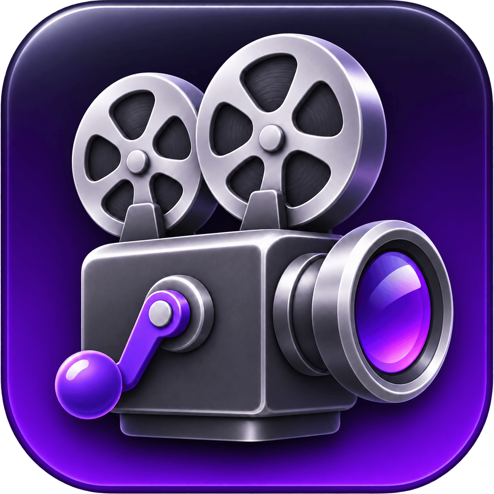
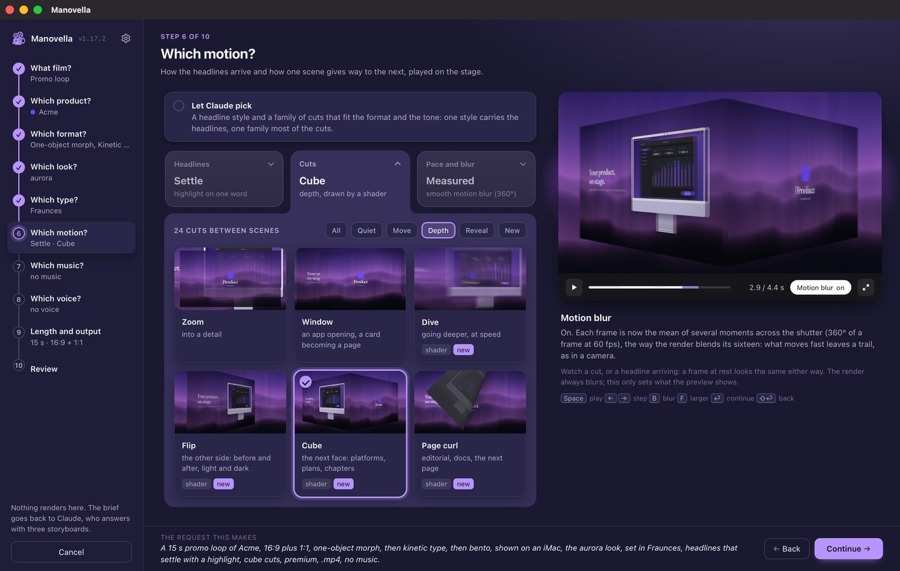
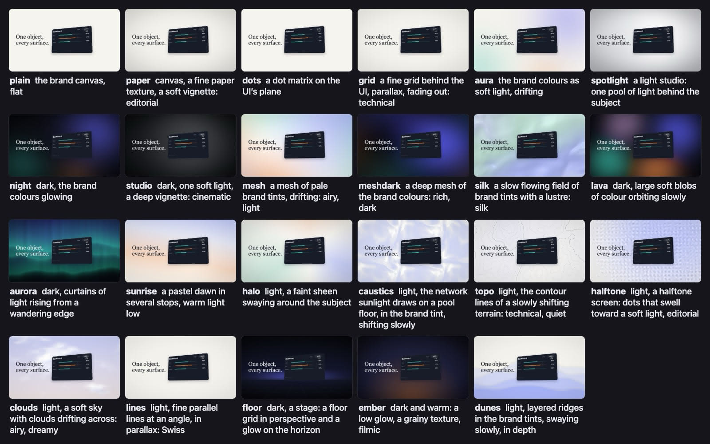
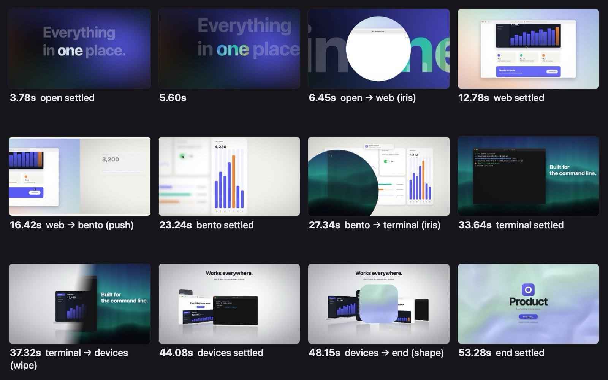
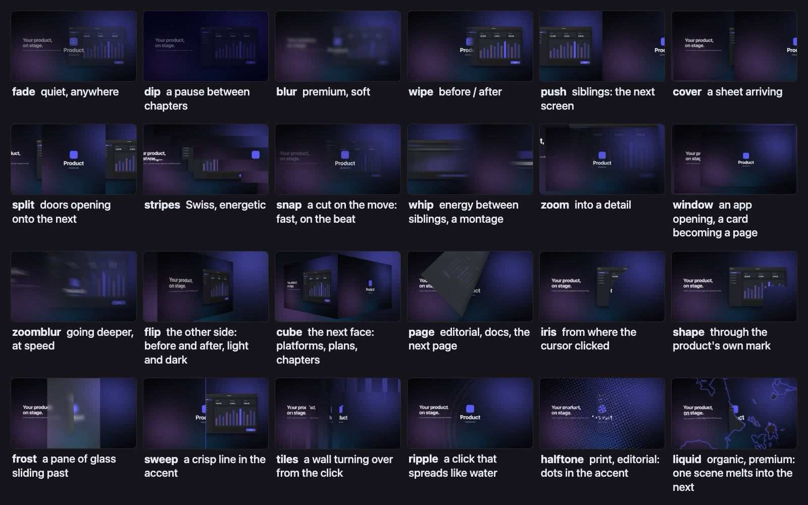
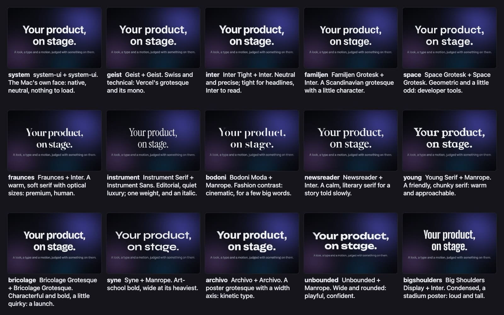
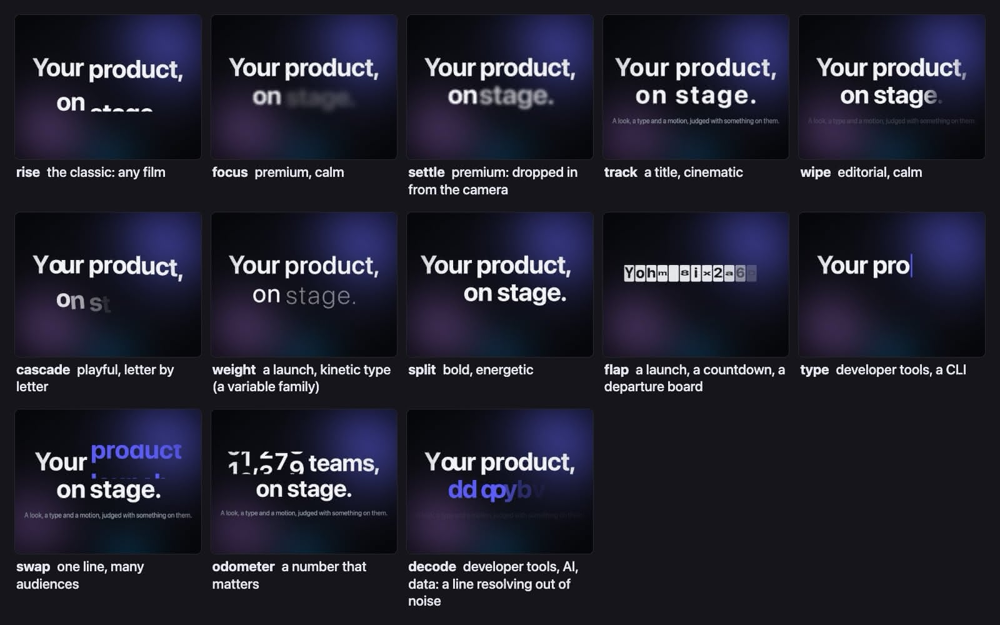
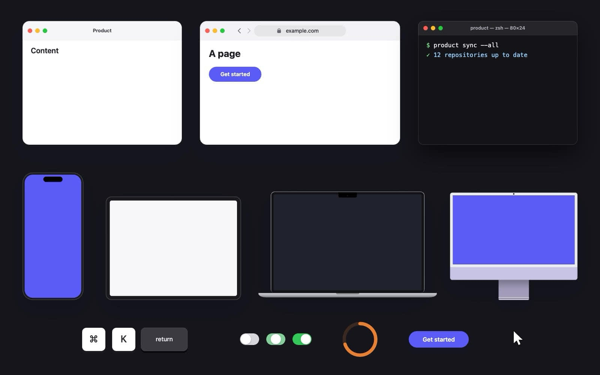

<p align="center"></p>

# Manovella

**Product films, written as code — and a Studio to brief them.**

<div align="center">

[<kbd> <br/> ❤️ If this tool has been useful to you or your team, please consider becoming a sponsor <br/> </kbd>](https://github.com/sponsors/gfazioli?o=esc)

</div>

<div align="center">
  <p><br>
  <sub>Made with <a href="https://github.com/gfazioli/glancecard">glancecard</a> · refreshed daily</sub></p>
</div>

Manovella makes promo, launch, release and tutorial films of your product with Claude Code. A film
is one HTML canvas whose every frame is a pure function of time, `seek(t)`: headless Chrome
captures it frame by frame, sixteen subframes each, and ffmpeg blends and encodes them. The film is
a function and the video a sampling of it, so any frame can be reviewed as a still, a change costs
a re-render of what changed, and a loop closes to the pixel.

*Manovella* is Italian for the hand crank of an old film camera, the one that advances the film
frame by frame.



> Manovella ships as a Claude Code plugin with its own marketplace, from this repository. It is
> macOS-first: the window, the thermometer and the voices are Mac code.

## What sets it apart

- **Every frame is a function.** No timeline state, no timers: `seek(t)` draws the frame at `t`
  from scratch, so a still, a draft and the master are the same drawing.
- **Real motion blur.** Each frame is the mean of sixteen subframes, each on its own subpixel
  offset, so it is a 16-sample antialias too; a fast move gets 48. The shutter goes from 360° to a
  film camera's crisper 180°.
- **Loops exact to the pixel**, checked, not eyeballed.
- **Your product's own UI, rebuilt as vector** from its source: windows, menus, a cursor and real
  shortcuts, sharp at any resolution, never a screen recording.
- **Release films from a tag**: what one version changed, shown changing in place, between two
  version cards.
- **Sound, heard before it is chosen**: music from your library or a file of yours, its beat
  measured and the cuts on it; a voice-over from a local voice model or a macOS voice, heard saying
  a line over that music; subtitles.
- **Cool renders.** A render is minutes of every core, so it runs in the `utility` QoS class on a
  third of the cores, and a governor holds the workers when the chip passes 80 °C.
- **Nothing renders on its own.** A film is made when it is asked for, after the storyboards and the
  stills have been seen.

## The Studio

`/manovella:studio` opens a window of its own: ten steps from a recipe to a brief, where every
choice is shown moving on the real engine, in your product's colour and the film's aspect, and the
sound is heard. Each step is a deck of cards, each card saying at a glance what is chosen in it. It
ends with a `brief.json` that Claude answers with three storyboards.

**What film** (promo loop, social teaser, film in chapters, release film, README GIF, tutorial,
from scratch)
· **which product** (a repository or a URL; its accent guessed from the source) · **format** (eleven)
and the **device** it is shown in (a Mac window, a MacBook, an iMac, an iPhone, an iPad, a browser,
a terminal, or the UI alone) · **look** (twenty-three, or a picture of yours) · **type** (fifteen
sets, or any installed family) · **motion** (thirteen ways for a headline to arrive, twenty-four
cuts, the pace, the shutter) · **music** (your music library, a file of yours, or a new one from
Gemini) · **voice** (six presets, thirteen voices made on the Mac and heard there, over the music;
subtitles) · **length** (the kind's own, or one you type) **and output** · **review**.

## The catalogue

<table>
<tr>
<td width="50%" valign="top"><br><b>23 looks</b>: backdrops, brand light, grain, glass, from flat to WebGL fields</td>
<td width="50%" valign="top"><br><b>11 formats</b>, the first decision of a film</td>
</tr>
<tr>
<td width="50%" valign="top"><br><b>24 cuts</b>, by what they do to the frame</td>
<td width="50%" valign="top"><br><b>15 type sets</b>, open-licensed, in the kit</td>
</tr>
<tr>
<td width="50%" valign="top"><br><b>13 headline styles</b>, how a claim arrives, with a mark on one word</td>
<td width="50%" valign="top"><br><b>8 devices</b>: a Mac window, a MacBook, an iMac, an iPhone, an iPad, a browser, a terminal, the UI alone</td>
</tr>
</table>

The full catalogue, with every look, format, part and transition in pictures, is the engine's
[README](plugins/manovella/skills/site-promo-film/README.md).

## How a film is made

1. **Ask**, in words or in the Studio: what film, of what, for where.
2. **Three storyboards**, on three different formats, on the music's beat grid. You pick one.
3. **Stills and a contact sheet** of the first real frames, the looks sheet if the look is open.
4. **A draft** at a sixteenth of the work (`PREVIEW=1`), then **the masters**: `.mp4` (H.264 or
   HEVC), `.mov` (ProRes 422 HQ), `.webm` or `.gif`, every aspect asked for, a cover per aspect,
   chapter marks for a long film. On the look `transparent`, rendered with `ALPHA=1`, a film comes out
   with its alpha, as `.mov` (ProRes 4444) or `.webm` (VP9 with alpha), to lay over footage
   (a film on a timeline needs an `under` for its cuts too: *Rendering*, in the guide).
5. **Delivery**: the finished films leave the work folder for a folder of their own; once the film
   is out, the work folder goes to the Trash after its source is checked safe in the product's kit.

## Requirements

- **macOS on Apple Silicon**, with Claude Code (Linux and Windows: below).
- **Node** (tested with 24.3), **ffmpeg** (tested with 9.0.2) and **Google Chrome**, which the
  renderer drives through `playwright-core` installed in each film's work folder: nothing else is
  downloaded. With Homebrew: `brew install node ffmpeg`, and Chrome from google.com/chrome.
- **Xcode Command Line Tools** (`swiftc`), optional: for the Studio's own window app and the chip's
  thermometer. Without them the Studio opens in a Chrome app window, and renders are held on
  macOS's thermal state instead of a temperature.
- **Voices, optional**: Python 3.13 (`brew install python@3.13`) and, once per Mac,
  `node <skill>/scripts/voice.mjs --setup` (a 600 MB environment in `~/.local/share/film-voice`;
  each model is downloaded at its first use: Chatterbox 3 GB, Orpheus 3.5 GB, Kokoro 330 MB, which
  also installs about 160 MB of text packages with `--setup kokoro`). Without them a film
  speaks with a macOS voice, or not at all.

### On Linux and Windows

macOS on Apple Silicon is Manovella's home, and the engine, the Studio and the renders run on Linux
(Windows through WSL2 too) and on Windows as well; CI runs them on both. What changes there:

- **Node, ffmpeg and Chrome** as above: on Linux `apt install ffmpeg` (or your distribution's) and
  Google Chrome from google.com/chrome (Chromium where Chrome has no build, as on linux-arm64); on
  Windows `winget install OpenJS.NodeJS.LTS`, `winget install Gyan.FFmpeg` and
  `winget install Google.Chrome`. A machine without a GPU draws
  the shader looks and cuts in software: slower previews and renders, the same frames.
- **The Studio** opens in a Chrome app window (the window app is macOS's), or the default browser.
- **Renders** run at below-normal priority, which Chrome and ffmpeg inherit. Linux reads the CPU's
  temperature for the heat governor; Windows has no sensor to read, so no governor there.
- **The Trash**: on Linux `gio` (GLib) or trash-cli; on Windows the Recycle Bin.
- **Voices**: the macOS voices (`say`) are the Mac's. The voice models run on PyTorch instead of
  MLX, from a Python 3.10 to 3.12: `--setup kokoro` (on the CPU, about 1.3 GB), and
  `--setup chatterbox orpheus` (best on an NVIDIA GPU with CUDA; their weights are about 4 and
  6.6 GB). A take said there is the same voice and words as on a Mac, not the same file.
- **Type**: SF Pro and SF Symbols are licensed for Apple platforms only, so a film of a Mac app is
  made on a Mac. Web products and command-line tools are not affected.

## Install

```sh
claude plugin marketplace add gfazioli/manovella
claude plugin install manovella@manovella
```

To update by hand: `claude plugin marketplace update manovella`, then
`claude plugin update manovella@manovella`. Or declare the marketplace in `~/.claude/settings.json` (merged into
what is there) and Claude Code keeps the plugin current:

```json
{
  "extraKnownMarketplaces": {
    "manovella": {
      "source": { "source": "github", "repo": "gfazioli/manovella" },
      "autoUpdate": true
    }
  }
}
```

The Studio's window is a small app of its own, built once per Mac (and after a change to the
window kit or to `studio.json`). Without it the Studio opens in a Chrome app window.

```sh
S=$(ls -d ~/.claude/plugins/cache/manovella/manovella/*/skills/site-promo-film | sort -V | tail -1)
"$S/studio/window/build.sh" "$S/studio"     # installs ~/Applications/Manovella.app
```

In another agent the skill is elsewhere: `~/.codex/plugins/cache/manovella/manovella/<version>/skills/site-promo-film`
(Codex), `~/.copilot/installed-plugins/manovella/manovella/skills/site-promo-film` (Copilot CLI),
`~/.gemini/extensions/manovella/skills/site-promo-film` (Gemini CLI's extension; `~/.gemini/skills/site-promo-film` for
the skill installed by itself).

### Other coding agents

The engine is Node, Chrome and ffmpeg, and the instructions are two Agent Skills, so three other
agents install Manovella too. The installs below are tested. In Copilot CLI so is a film's way from
the Studio to its stills (the Studio detached and waited on, the brief read, three storyboards, a page
built, stills and a contact sheet); Codex and Gemini CLI are next
([#1](https://github.com/gfazioli/manovella/issues/1)). How good the film is follows the agent's
model.

| Agent | Install | The Studio |
| --- | --- | --- |
| Codex CLI | `codex plugin marketplace add gfazioli/manovella`, then `codex plugin add manovella@manovella` | ask for Manovella's Studio |
| GitHub Copilot CLI | `copilot plugin marketplace add gfazioli/manovella`, then `copilot plugin install manovella@manovella` | ask for Manovella's Studio |
| Gemini CLI | `gemini extensions install https://github.com/gfazioli/manovella`, from the first release that carries the extension (`manovella-gemini.tar.gz` as its only asset); before it, each skill by itself: `gemini skills install https://github.com/gfazioli/manovella --path plugins/manovella/skills/site-promo-film`, and the same with `release-film` (uninstall those two with `gemini skills uninstall` before installing the extension: a skill installed by itself overrides the extension's) | `/manovella:studio` with the extension, else ask for Manovella's Studio |

A film installs packages and voice models from the network, writes its work folder outside the
project (`~/Downloads/<name>-work`), starts Chrome and the Studio's window, and renders for minutes.
Give the agent room for that:

- **Codex**: its default sandbox (`workspace-write`, no network) asks at every such command; approve
  them, or start it with `--sandbox danger-full-access` for a film.
- **Copilot CLI**: `--add-dir ~/Downloads` (or `--allow-all-paths`) and `--allow-all-urls` for the
  downloads, or `--allow-all` for both.
- **Gemini CLI**: it asks before each tool; `--approval-mode auto_edit` approves its file edits,
  `yolo` every tool.
- **Every agent**: a render at 1080p60 takes about 29 times the film's length, so the shell's
  command timeout must allow it, or the render goes on detached and resumes with `RESUME=1`.

## Settings

Nothing needs configuring. One optional thing does: a **music library**, a folder with the music
of your films. The Studio offers every audio file (mp3, m4a, aac, wav, aiff, flac, ogg) at its top level
and in each folder in it, directly or in that folder's `audio/` folder. A folder per brand is
optional and groups its tracks; the folder named after the product is listed first. Dot-folders
and the names in `musicLibraryIgnore` are skipped.

```
<library>/track.mp3                    a track at the top
<library>/<Brand>/audio/               a brand's tracks, with <brand>-music-notes.txt beside them
                                       (a paragraph per track, starting with its file name)
<library>/<Brand>/video/<name>/        delivered films, when you ask for that
```

Point Manovella at it with the environment variable `MANOVELLA_MUSIC` (for one run), or in
`~/Library/Application Support/manovella/settings.json` (`~/.config/manovella/settings.json` on
other systems); a leading `~` is expanded. Nothing is auto-detected.

```json
{
  "musicLibrary": "~/Documents/Music",
  "musicLibraryIgnore": ["Archive", "Templates"],
  "deliverToLibrary": false
}
```

`deliverToLibrary` (default false) delivers finished films into the library too, in
`<library>/<Brand>/video/<name>/`. Otherwise, or without a library, a film goes where the project's
own instructions keep finished media, else `<name>/` in the work folder (`~/Downloads` unless
`workRoot` says otherwise). A new track made with Gemini is saved in the library (in the product's
folder when the library keeps one per brand), with its paragraph in that folder's notes file;
without a library it just goes in the film's `src/audio/`. An older file with `brandLibrary` and
`brandLibraryIgnore` is read as `musicLibrary` and `musicLibraryIgnore` with `deliverToLibrary` on,
what it did before, and is rewritten with the new keys at the first change you make in the Studio's
Settings.

The Studio's **Settings** (the gear beside the logo, or **Settings…** in the app menu, <kbd>⌘</kbd>,)
writes this file for you: a change is saved at once and a folder is chosen with the Mac's folder
picker. The same file takes three more optional keys; a folder that is not there counts as unset:

```json
{
  "projectFolders": ["~/Documents/Code"],
  "pictureFolders": ["~/Pictures", "~/Documents/Backdrops"],
  "workRoot": "~/Documents/Films"
}
```

- `projectFolders`: folders whose git repositories (two levels deep) the Studio offers as products.
  Unset: the parent of the repository the Studio starts in, its siblings.
- `pictureFolders`: folders whose most recent pictures (three levels deep) the Studio offers as
  backdrops. Unset: `~/Pictures`.
- `workRoot`: where a film's `<name>-work` folder and, unless it is delivered into the library or the
  project has an instruction, its `<name>/` delivery go. Unset: `~/Downloads`.

On the command line, `--roots` (or `MANOVELLA_ROOTS`) and `--out` win over `projectFolders` and
`workRoot` for one run, and `MANOVELLA_MUSIC` over `musicLibrary`.

## Use

| Ask | What happens |
| --- | --- |
| `/manovella:studio` | The Studio, ending in a brief that Claude answers with three storyboards. |
| `/manovella:site-promo-film` | A promo, launch, teaser, tutorial or explainer film of a product, site or app; `?` is the guided mode. |
| `/manovella:release-film` | A "what's new" film of one release, the changed surfaces rebuilt from the app's source at the tag. |

Or just ask: *"a 15 s promo loop of acme.app, 16:9 and 9:16, with our music"*.

## Layout

| Path | What it is |
| --- | --- |
| `plugins/manovella/skills/site-promo-film/` | The engine (`template/`), its tools (`scripts/`: render, beats, voice, mix, deliver), the Studio (`studio/`) and its window kit (`studio/window/`). |
| `plugins/manovella/skills/release-film/` | Release films, on the same engine. |
| `plugins/manovella/commands/studio.md` | `/manovella:studio`. |
| `.claude/skills/verify/` | How to verify a change to the engine without rendering a film. |

One version for the whole product, in `plugin.json`, the marketplace entry and `studio/studio.json`;
the Studio's selftest fails when they disagree.

## Sponsor

<div align="center">

[<kbd> <br/> ❤️ If this tool has been useful to you or your team, please consider becoming a sponsor <br/> </kbd>](https://github.com/sponsors/gfazioli?o=esc)

</div>

Your support helps me:

- Keep the project actively maintained with timely bug fixes and security updates
- Add new features, improve performance, and refine the developer experience
- Expand test coverage and documentation for smoother adoption
- Ensure long-term sustainability without relying on ad hoc free time
- Prioritize community requests and roadmap items that matter most

Open source thrives when those who benefit can give back—even a small monthly contribution makes a real difference. Sponsorships help cover maintenance time, infrastructure, and the countless invisible tasks that keep a project healthy.

Your help truly matters.

💚 [Become a sponsor](https://github.com/sponsors/gfazioli?o=esc) today and help me keep this project reliable, up-to-date, and growing for everyone.

## License

MIT, see [LICENSE](LICENSE). The fonts in `plugins/manovella/skills/site-promo-film/template/fonts/` keep their own open licences, in a file beside each family.
