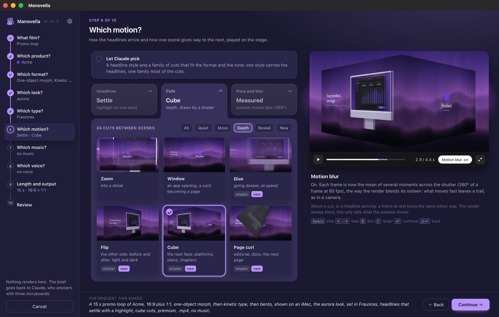
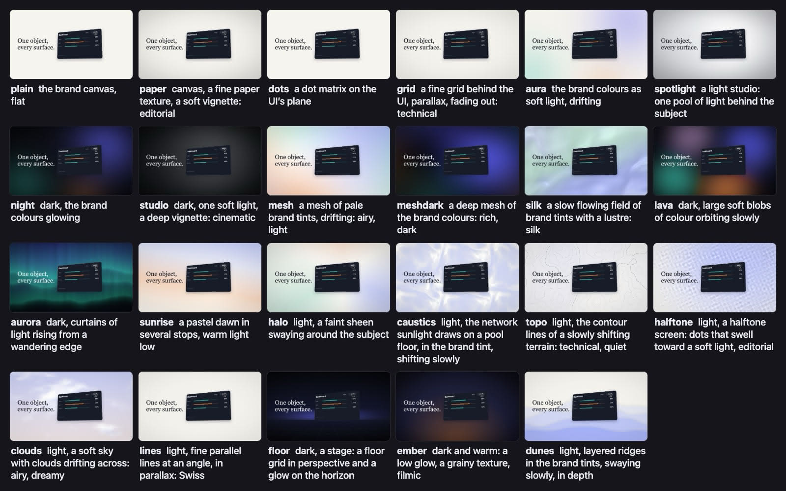
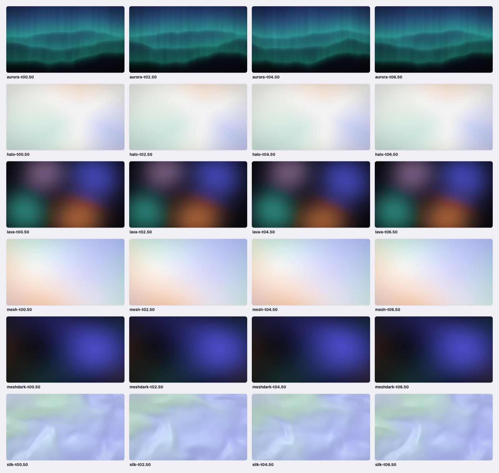
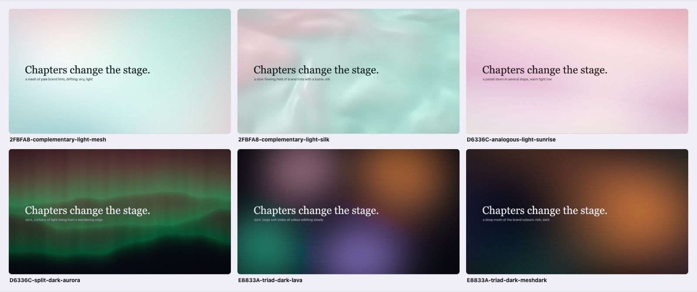
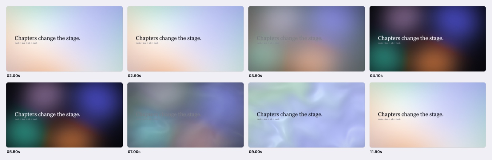
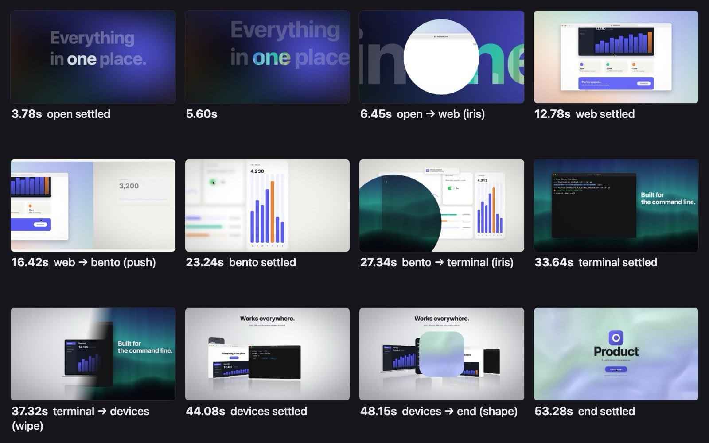
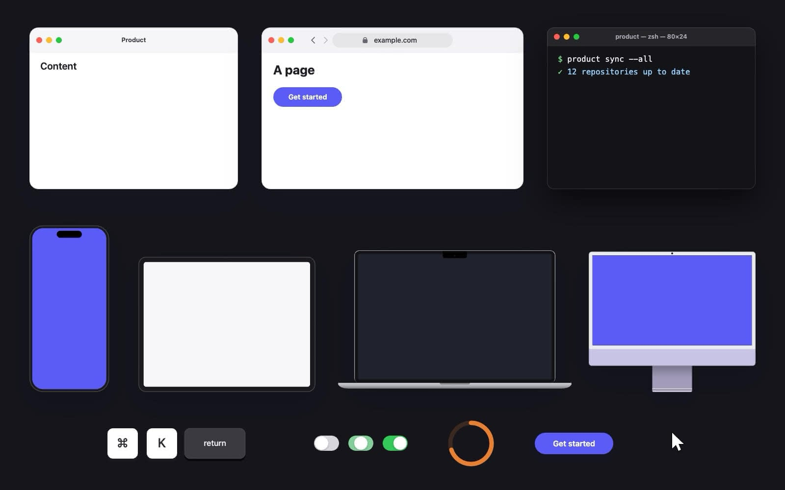
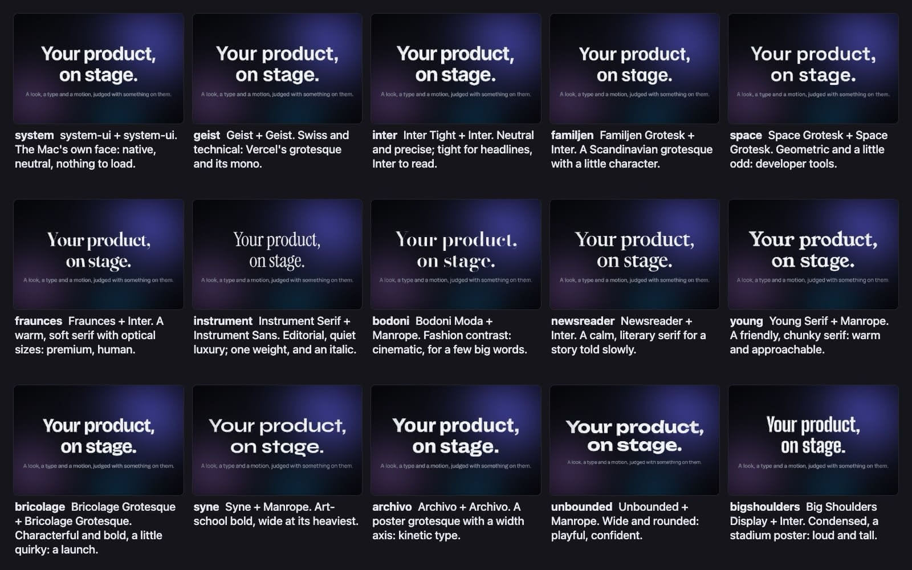
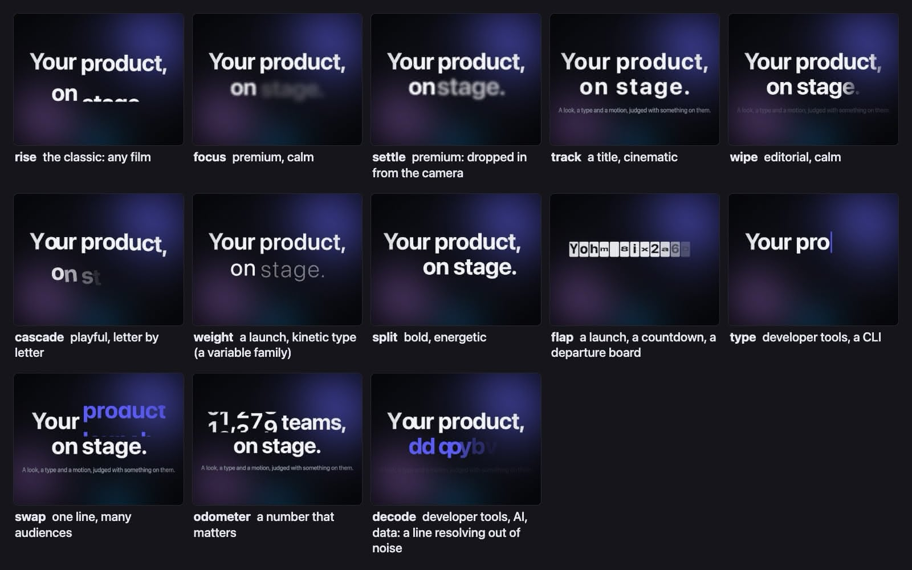
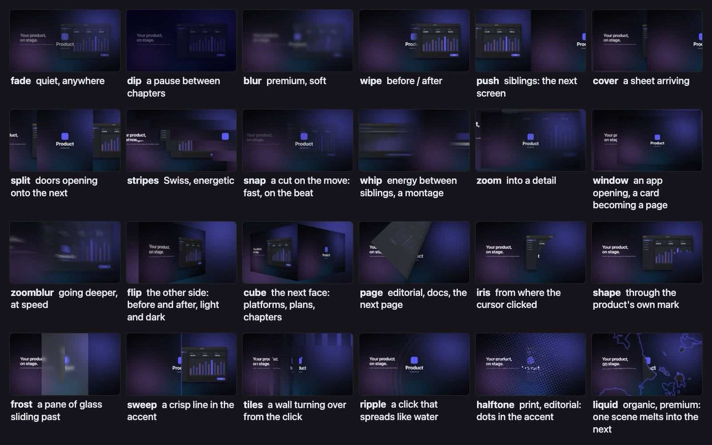

# Films as code

The engine behind `manovella:site-promo-film` and `manovella:release-film`. A film is an HTML
page whose `seek(t)` draws the frame at time `t` from scratch; headless Chrome captures it frame
by frame, sixteen subframes each, and ffmpeg blends and encodes them. The film is a function and
the video a sampling of it: every frame can be reviewed as a still, a change costs a re-render of
what changed, and a loop closes to the pixel.

**A film is made only when the user asks for one** — never as a step of a release, never as a
demo on the side. And a render is a sustained load on
every core, so it runs cool by default ([Heat](#heat)).

## The Studio: choose by eye

**`/manovella:studio`**, or the skill with no argument, opens a window of its own: ten steps
from a recipe to a brief, where the recipes, the formats, the looks, your pictures, the type and the
motion are shown moving on the real engine, in the product's colour and the film's aspect, and the
sound is heard: your music library's tracks, and a voice saying a line before you choose it, over the
music chosen. Each step is a deck of cards, each card saying at a glance what is chosen in it. It ends
with `brief.json` in the film's work folder, the picture, the fonts and the track it needs beside it, and hands
it back to Claude, who answers with the storyboards. Nothing is installed and nothing renders.



The tile under the pointer plays, and the viewer goes back to the choice when the pointer leaves:
a hover is a look, not a choice. The window is dark and keeps Manovella's violet whatever the product (its
colour is in the previews, and beside its name in the steps), the viewer scrubs by dragging, and from the keyboard: Space plays, ← → step, B is the motion blur, F a larger
preview, Enter continues and Shift+Enter goes back. Going back keeps every choice, and so does
another recipe for the ones made by hand; when Continue is off, the page says what it waits for;
the window works down to 900 x 600, its sidebar reduced to the steps' numbers.

| Step | What you choose | Seen as |
| --- | --- | --- |
| What film? | a recipe: promo loop, social teaser, film in chapters, release film, README GIF, tutorial, from scratch | each recipe's own template, playing |
| Which product? | a repository among the workspace's siblings, or a URL; the version for a release; the name | its homepage, latest tag and film kit, and a guess at its accent (the kit's last film, an Xcode AccentColor, a manifest's `theme_color`, a `--brand` variable) |
| Which format? | up to three of the eleven, or Claude's pick of three; and the device the product is shown in (a Mac window, a MacBook, an iMac, an iPhone, an iPad, a browser, a terminal, just the UI), or each format's own | the reel's scenes, on hover, in your colour and look; the stand-in product in each device, laid out as that device has it |
| Which look? | one of the twenty-three, a sheet of the first real frame later, or a picture from your Mac (dropped, chosen, or among the recent ones in Pictures, or in the picture folders you add in Settings) with its blur, treatment (dimmed, brand tint, duotone) and a Ken Burns; the palette scheme | every look rendered on a stand-in product (`studio/stage.html`), in your colour and aspect |
| Which type? | a type set from the kit (display, text, mono), any family from the kit or installed on this Mac and its weight, or the brand's own | each set as a specimen in its own faces; the headline set large on the stage |
| Which motion? | how the headlines arrive (thirteen styles), an emphasis on one word, the family of cuts (twenty-four, by what they do to the frame: quiet, move, depth, reveal), the pace, the motion blur's shutter | each style and each cut playing on the stage, in your look and type, at the pace chosen; a cut's two seams marked on the scrubber |
| Which music? | a track of your music library (with its notes; see the front README's *Settings*), a file of yours, a prompt for Gemini to make a new one, a metronome, or none | each track played, with its length and tempo measured |
| Which voice? | a voice-over for any film: a preset (Promo, Launch, Narrator, Conversational, Recap, Lesson: a voice and its reading at once, from `studio/schema.json`), or by hand a voice model (Chatterbox, Orpheus's eight voices, or Kokoro's four) with its tone, speed and human touch, a macOS voice, your recordings, or none; what it says; the subtitles; how far under the voice the music sits | a *Hear it* strip over the step's cards: the chosen voice saying the line you type, the way the film will say it, over the music chosen or alone; the subtitles under the stage |
| Length and output | length (the kind's own, or one you type: 3 to 60 s for a promo, 30 s to 15 min for a film or a tutorial; a film that speaks can last as long as its voice), aspects, tone, fps, resolution, files, reference, notes; for a tutorial, what it teaches | the stand-in laid out for the aspect you click; a rough render time |
| Review | the brief, each line editable | the one-line request that would have said it all |

- **The previews are the engine's own pages**, played by calling their `seek(t)`. A look seen here is
  the look the renderer draws. One page plays at a time, at 60 fps when a frame is cheap and 30 when
  it is not; a new one cross-fades in over the last, and a paused one is not drawn again. **Motion
  blur** in the viewer's bar paints each frame as the mean of up to five moments (as many as fit in
  the frame's time), the way the render blends its sixteen: the way to judge a fast move. A WebGL
  backdrop is drawn at the viewer's own size (`?gl=0.5`): in the Studio's window (WebKit) a mesh
  look went from 20 frames a second to about 50, and from 4 to 25 with motion blur.
- **Every choice comes from `studio/schema.json`**: fields with their types and defaults, recipes,
  formats, frames, looks, type sets, styles, cuts, picture options. A new one added there appears in the
  wizard (and must exist in `fx.js`, `type.js` or `film.js` too).
- **Pictures** are converted once with `sips` (HEIC included) to a JPEG of at most 3840 px in
  `~/Library/Caches/manovella/`, and the chosen one is copied into the work folder. A film work
  folder's own renders are not offered. The brief records where the picture came from: a wallpaper
  pack's licence is often personal use only.
- **By hand**: `node studio/studio.mjs` from a workspace. It prints `STUDIO <url>`, then one of
  `BRIEF <path>`, `CANCELLED`, `CLOSED` or `TIMEOUT`, and exits. Options: `--no-open` (just the URL),
  `--roots <dir>,…` (where the repositories are), `--product <path>` (preselected), `--out <dir>`
  (default: the work folder, `~/Downloads` unless Settings › Work folder says otherwise),
  `--agent claude|codex|copilot|gemini` (who the brief goes back to: the Studio names it, and its end
  screen gives that agent's command; without it, Claude inside Claude Code, else "your agent" and
  every agent's command). `--detach` is for an agent that no background command's exit wakes: the
  Studio goes on by itself, and the command prints `STUDIO <url>` and `STATE <file>` and returns;
  `node studio/studio.mjs --wait <file> [--for <seconds>]` then prints the ending line, or `WAITING`
  after 240 s, to be run again. The window is the Studio's own app, `~/Applications/Manovella.app`,
  where it has been built from the window kit
  (`studio/window/build.sh studio`): its name, version and
  icon in the Dock instead of one more Google Chrome.
  Otherwise, or with `MANOVELLA_WINDOW=chrome`, a Chrome app window on a profile of its own.
  Either way it closes with the Studio.
- **Its version** is Manovella's: one number in `studio/studio.json`, the plugin's `plugin.json`
  and the marketplace entry, shown beside its name in the sidebar. Bump all three with every
  change, patch for a fix, minor for a feature.
- **It remembers** the last brief, per product, in `~/Library/Application Support/manovella/`:
  *Like last time* starts from it.
- **`node studio/selftest.mjs [--shots <dir>]`**, from a folder with `playwright-core`, drives a promo
  brief through all ten steps (a picture, a type set, a style, a cut, a track of a stand-in music library, a voice) and a release brief in
  headless Chrome, then every way the Studio ends and the window it opens (the app stood in for
  under a temporary home; about 260 checks, a few minutes on an M5 Pro); it never opens a visible window and never
  touches your prefs, your cache or your Downloads. `--shots` keeps each step as a
  picture: the run proves the flow, the pictures show the screen.
- **`node studio/transcheck.mjs [--shots <dir>] [--text <dir>] [--type <dir>]`**, from the same folder, plays every
  transition on the stage and holds each to the pixel: its first frame is the scene it leaves, its
  last the scene it brings, both ways (a cut that fails this pops), its shader compiles, and a frame
  of it takes so long. `--shots` and `--text` keep the stills the two sheets below are made of, and `--type`
  those of the fifteen type sets; `--size WxH` sets the stills' shape, and the stage takes the `--look`'s own
  tone (`--look night` is a dark stage). The catalogue's six pictures are all 1600 × 1000, 16:10, and dark, as
  the README on GitHub and the site show them: the cuts, headlines and type sets on `--look night`, laid on
  `node contact.mjs <dir> out.jpg <columns> --size 1600x1000 --font 20 --dark`, never cropped; the parts
  with `PAGE='parts.html#dark'`.
  `--sheer` runs the other case, two scenes that draw no backdrop over the timeline's `under`: fourteen
  kinds are right there (`fade`, `dip`, `push`, `frost`, `snap`, `tiles` and the shaders), ten lay one
  scene over the other and pop on the last frame, and it says which.

## Asking for a film

You ask in words, in any language, and nothing renders on its own. Each request below is one
message: the skill fills whatever it does not say with a default, asks what it cannot guess, and
waits for you three times, at the storyboards, at the contact sheet and at the delivery.

Not sure what to ask? **`/manovella:site-promo-film ?`** is the guided mode: what it makes, these
examples, then the brief in two rounds of questions, ending with the one-line request that would
have said it all. `? looks`, `? formats`, `? render` or `? delivery` answer one topic.
`/manovella:release-film ?` does the same for a release.

### A first film

| Ask | You get |
| --- | --- |
| *Make a 15-second promo loop of https://acme.app: premium, dark, no music.* | Three storyboards on three formats, one recommended, then a wait for your pick. |
| *A 60-second film of Acme from its repo, one chapter per feature, 16:9 for YouTube.* | A film on a timeline, chapter marks in the mp4, the chapter list for the description. |
| *A 9:16 teaser of acme.app for social, 10 s, kinetic type on the site's own headline.* | A vertical loop made of the site's own words. |
| *A 6-second GIF loop for the README: the terminal typing `acme init`, 960 px wide.* | A terminal film, encoded as a GIF. |
| *Like last time's promo, but on the grid look with the brand's orange as the only colour.* | The product's kit reused, the look changed. |

### A release

| Ask | You get |
| --- | --- |
| *Release film for Acme 2.4 from the v2.4.0 tag: the three changes that show best, 16:9 plus a square cut.* | The changes read from the tag, a line on why each one shows well, one storyboard when the product already has a kit. |
| *A what's-new clip for 2.4 with only the new export sheet, 12 s, for the release notes.* | One featured change, between two version cards. |
| *Three storyboards for 2.4, I'll publish them in different places.* | A, B and C, each with its square cut, delivered side by side. |

### Review rounds

- *Show me the looks sheet on the first real frame.* Every preset on one sheet, to choose by eye.
- *Storyboard B, with A's ending.*
- *The headline lands on the click, not before, and a slower camera in the second scene.*
- *Render 12–20 s at full quality, I want to see that transition.* One range (`FROM`, `TO`).
- *A fast draft of the whole film first.* `PREVIEW=1`, about 16x faster.
- *Put a metronome under it, so I can hear whether the cuts land.* `AUDIO=click`.
- *Put this track under it.* `AUDIO=track.mp3`, brought to -14 LUFS (`AUDIO_LUFS`, or `AUDIO_NORM=0` to keep it as it is).
- *Cut it on the track's beat.* `beats.mjs track.mp3` measures it: the page takes its bpm and starts on
  a bar (`AUDIO_AT`), or follows a track that drifts beat by beat (`FILM.beats`); the render checks
  that the page's beats land on the track's.
- *Crisper motion, like a film camera.* `SHUTTER=180` (or `PROMO_META.shutter`): the sixteen
  subframes cover half of each frame instead of all of it.

### Other formats of the same film

- *Also as .webm for the site, and a 960 px GIF.* With `KEEP=1` on the master, an encode in seconds
  rather than a new render.
- *A ProRes copy for Final Cut.* A `.mov`, ProRes 422 HQ.
- *A lighter mp4 under 8 MB for the newsletter.* Re-encoded from the master, not rendered smaller.

### Delivery and cleanup

- *Deliver it.* The finished films and their covers into `<name>/`, where your instructions keep
  finished media (else the work root, `~/Downloads` by default), and nothing else.
- *The film is out: throw the work folder away.* A dry run first, listing anything that exists
  nowhere else; then your OK; then the Trash.
- *Commit the kit to the repo, then clean up.* The source into the product's `scripts/film/`,
  pushed, and only then the work folder.

## Quick start, by hand

```sh
W=~/Downloads/acme-promo-work && mkdir -p $W/src
cp template/{reel.html,film.js,fx.js,parts.js,type.js} scripts/{render.mjs,contact.mjs,deliver.mjs,clickcheck.mjs,layoutcheck.mjs,thermo.swift} $W/src/
cd $W/src && npm i playwright-core
PAGE=reel.html node render.mjs sheet sheet && node contact.mjs sheet sheet.png 4   # stills to review
PAGE=reel.html PREVIEW=1 node render.mjs video ../draft.mp4                       # a draft, ~16x faster
PAGE=reel.html node render.mjs video ../acme-promo.mp4                            # the master
PAGE=reel.html node render.mjs stills stills 0                                    # its cover
node deliver.mjs ~/Downloads/acme-promo ../acme-promo.mp4 stills/t00.00.png=acme-promo-poster.png
DRY=1 node deliver.mjs trash $W --kit <repo>/scripts/film                         # once the film is out
```

The skills' `SKILL.md` files are the method (how to ask, storyboard, source the brand, direct,
verify); this page is the catalogue.

## What is in it

| File | What it is |
| --- | --- |
| `template/promo.html` | A loop: one object travelling through the product's surfaces, a real cursor, 3D in WebGL. |
| `template/reel.html` | A long film on a timeline: six scenes, six formats, five transitions, a look per chapter. |
| `template/film.js` | The stage (subpixel jitter), rasters that hold still, springs and cameras, the timeline, transitions, effects. |
| `template/fx.js` | The looks: backdrops, fields, pictures, light, texture, glass, click ripples, palettes, chapter sequences. |
| `scripts/narrate.mjs` | A tutorial's story into a voice, a clock and subtitles (`narration.wav`, `narration.js`, `captions.srt` / `.vtt`). |
| `scripts/words.mjs` | Word-level timing for a voice-over: Whisper hears each recording, so an action can land on the word that names it (`FILM.word(NARRATION, 'open', 'menu')`); `voice.mjs --setup words` fetches the model. |
| `scripts/sfx.mjs` | Sound effects made in code, optional: clicks, cuts and typed letters from the page's own clock, each one frame after its picture event; `mix.mjs --sfx` lays them under the voice. |
| `scripts/voice.mjs` | The story told by a voice model on the Mac instead of `say` (`voice-mlx.py`, `voice-constraints.txt`), at a tone, with a human touch; `--setup` once on each Mac. |
| `scripts/mix.mjs` | A voice and a music track into one soundtrack: the music measured under the voice, up between lines. |
| `template/type.js` | Headlines: thirteen styles of arrival, an emphasis, a pace, `TYPE.load` for a family's faces. |
| `template/fonts/` | Twenty open-licensed families with their licences, and `fonts.json`. |
| `template/parts.js` | Vector parts: a macOS window, a browser, a terminal, an iPhone, an iPad, a MacBook, an iMac, keycaps, a switch, a ring. |
| `template/parts.html` | Every part on one 16:10 sheet, a page like the others: `PAGE=parts.html node render.mjs stills parts 0` makes the PNG that `docs/parts.jpg` is converted from (`sips -s format jpeg -s formatOptions 92`). |
| `scripts/render.mjs` | `stills`, `sheet`, `looks`, `loopcheck`, `video`, `beats`: formats, chapters, resumable chunks, the heat governor, the beat check. |
| `scripts/contact.mjs` | A captioned contact sheet of a folder of stills, at its natural height or exactly `--size WxH` (`--font`, `--gap`, `--pad`; a `.jpg` is a JPEG), light by default or `--dark` (#15151b, light captions) for a picture on a dark page. |
| `scripts/clickcheck.mjs` | Is every click seen: the camera still, the cursor at rest before the press and through it. |
| `scripts/layoutcheck.mjs` | Is every headline in the frame, clear of the others, big enough to read on a phone and readable on what is behind it, at each moment worth a still. |
| `scripts/settings.mjs` | The user's settings (`settings.json`): project and picture folders, the music library, where films are made and delivered. |
| `scripts/beats.mjs` | A soundtrack's tempo, beats, bars and sections, from its samples; the bpm and `AUDIO_AT` that put the film on its beat. |
| `scripts/thermo.swift` | The chip's temperature without sudo, for the governor. |
| `scripts/deliver.mjs` | The finished films into a folder of their own, and the work folder to the Trash once its source is safe. `--for x`: X's limits for a video or a GIF, each measured on the file. |
| `scripts/fonts.mjs` | Another family for the kit, from Google Fonts with its licence; `check`, `list`. |
| `guide.md` | The guided mode: what `?` does. |
| `studio/` | The Studio: `studio.mjs` (the server, the window, the brief), the wizard (`index.html`, `studio.js`, `studio.css`), `stage.html` (the stand-in everything is previewed on), `schema.json`, `studio.json` (its name and version) and `icon-1024.png` (its window app's), `selftest.mjs` and `transcheck.mjs` (every transition, held to the pixel at both ends). |
| `../release-film/template/release.html` | A "what's new" film: the change happening in place, on a version card. |

## Looks

Twenty-three presets, one line in a page: `FX.look({ preset: 'mesh', palette: C })`, or `#look=mesh`
in the URL to try one without editing. `node render.mjs looks looks 4.5` renders a frame once per
preset; this is that sheet on the promo demo. Among them, `caustics`, `topo`, `halftone` and
`clouds` are WebGL fields, and `lines`, `floor`, `ember` and `dunes` are drawn in 2D.



And a picture of your own as the backdrop, cover-fit and baked once: `FX.look({ preset: 'photo',
palette: C, base: { image: 'backdrops/x.jpg', blur: 10, duotone: ['deep', 'pale'], drift: 0.04 } })`
— `tint` lays the brand over it instead, `dim` darkens it for light text, `drift` is a slow Ken
Burns that still closes the loop.

The fields move, slowly, a whole number of cycles per film, so a loop still closes and a
five-minute film moves no faster than an eight-second one:



A whole palette from one colour, `FX.palette('#2FBFA8', { scheme: 'complementary', tone: 'light' })`,
and a stage that changes by chapter, `FX.sequence([[0, a], [24, b], …], { fade: 0.8 })`:




## Formats

The first decision of a film, and the one to vary: three storyboards are three formats, not three
pacings of one idea. `reel.html` runs six of them, with the stills `render.mjs sheet` takes at
every scene settled and every transition half done:



| Format | Fits |
| --- | --- |
| One-object morph | an app with a strong shape language |
| Kinetic type | a launch, a teaser, a manifesto |
| Browser walkthrough | a web product, a site |
| Bento | a product with many small features |
| Terminal | a CLI, a developer tool |
| Devices in 3D | cross-platform, "works everywhere" |
| Zoom-through | a story of depth: each scene inside a detail of the last |
| Data story | monitoring, analytics, a quota |
| Before / after | a speed-up, a redesign |
| Tutorial | onboarding, a long film |
| What's new | a release (`release-film`) |

## Parts

The surfaces a film is built from, as vector: they zoom without ever turning soft, and each
returns the rect its content goes in (`parts.js`). `template/parts.html` draws all of them on one 16:10
sheet, and is this picture, on its dark floor: `PAGE='parts.html#dark' node render.mjs stills parts 0` (without `#dark`, a light one), then a JPEG of the PNG.



## Type

Twenty families in the kit (`template/fonts/`, open-licensed, latin and latin-ext), in fifteen sets
of a display face, a text face and a mono, each a register of its own; or any family installed on
the Mac, by its name. `await TYPE.load('Fraunces', faces, 'fonts/')` before frame 0, then the family
in `TYPE.draw`:



## Tutorials

The Studio's **Tutorial** recipe is a film that is told: one task from start to finish, with a voice
and subtitles, as long as its story takes. `scripts/narrate.mjs` turns the story (a sentence a step)
into the voice, the clock and the subtitles; the page reads the clock back (`FILM.narrated`), so each
scene lasts as long as its sentence and a line rewritten is a film retimed; `FILM.captions` draws the
subtitle of the moment.

```sh
node voice.mjs --setup chatterbox orpheus kokoro   # once on each Mac: the Python that runs the voice models, and the models
node voice.mjs story.json                      # a voice model ("mlx" in the story): voice-mlx/*.wav, then all that narrate.mjs writes
node narrate.mjs story.json                    # the Mac's voice: voice/*.aiff, narration.wav, narration.js, captions.srt, captions.vtt
node narrate.mjs story.json --from recordings  # yours, or another synthesizer's: one file a step
AUDIO=narration.wav AUDIO_LUFS=-16 PREVIEW=1 node render.mjs video draft.mp4
```

Measured (macOS 27, `say`): the same sentence, voice and pace give the same file to the byte; an
eight-step story came to 41.2 s, 33.6 s of them spoken, at about 170 words a minute; a 6.6 s draft
with its voice rendered in 12 s.

**A voice model sounds closer to a person than any voice of `say`.** Three were chosen by ear
(Chatterbox and Orpheus in US English, tried in no other language; Kokoro in US English and Italian,
and no other), all free, local and offline once downloaded,
run by mlx-audio on an Apple Silicon Mac: Chatterbox Turbo (`"model": "chatterbox"`, 3 GB, one
voice, even and calm: a lesson, at `"tempo": 0.88`) and Orpheus (`"model": "orpheus"`, its voice "leah" unless
`"voice"` names another, 3.5 GB, warmer: a promo) and Kokoro (`"model": "kokoro"`, 330 MB, about ten times
smaller and quick: a draft, or a film in Italian with its voice `if_sara`; `af_heart`, `af_bella` and
`am_michael` are its English ones). Kokoro needs its language beside the voice (`lang_code`): `voice-mlx.py`
takes it from the voice's first letter (`i` Italian, `a` American English), or from `"lang"` in `"mlx"`; it has
no sampling temperature, so a tone changes nothing for it. A story with `"mlx": { "model", "voice", "tempo", "level",
"seed" }` is told by `voice.mjs`, which says each step, trims, paces and levels it (to -18 dB mean,
the mean `say` has, with a limiter at -1 dB), then calls `narrate.mjs`; `narrate.mjs` alone stops on
such a story rather than saying it with `say`.

- **A take is a seed.** The same model, voice, words and seed gave the same WAV to the byte, twice
  in the same environment and again in a second one made from nothing (Chatterbox and Orpheus: Kokoro's
  differ by one 16-bit step from run to run, with the same length); another seed reads the line
  another way. The take someone heard is the seed written on the step. `--audition 3` says three
  takes a step into `voice-mlx/audition`, to listen to, and prints their lengths for whoever cannot.
- **Per Mac, once:** `node voice.mjs --setup chatterbox orpheus kokoro` makes a Python 3.13 environment in
  `~/.local/share/film-voice` (600 MB; `brew install python@3.13` first when there is none) with
  mlx-audio and everything under it at the versions of `voice-constraints.txt`, downloads the models
  named into `~/.cache/huggingface`, says a fixed line with each and prints its SHA-256 beside the
  one recorded in `voice.mjs` (none for Kokoro, whose bytes are not repeatable). Asking for `kokoro` also
  installs its text packages, pinned in `voice-constraints-kokoro.txt` (spaCy, misaki, the espeak-ng
  library: about 160 MB, wheels only, nothing from Homebrew). **The same** means a seed is the same recording on two Macs, and a
  film approved on one can be told again on the other. **Not the same** means it cannot: bring the
  film's `voice-mlx` folder over, or have the new takes heard. Without the environment `voice.mjs`
  stops and names the command; it never falls back to another voice. `VOICE_PYTHON=<python>` uses
  another Python.
- The models have no speed and no volume of their own: `tempo` (0.85 to 1.15, pitch kept) and
  `level` are worked on the recording, so changing them says nothing again.

**Of the Mac's own voices, which one is most of how it sounds, and they are per Mac too.** The ones every Mac has are compact
(22 kHz: Samantha, Daniel, Alice) or plainly synthetic (16 kHz: Eddy, Flo, Reed). Premium and
Enhanced ones are a free download, once on each Mac: System Settings › Accessibility › Read &
Speak (Spoken Content on older macOS) › System voice › Manage Voices… They are for a language the
voice models were not tried in (Kokoro's Sara speaks Italian): a film in English is told by a model. The Studio
lists a Mac's voices best first, says under them what it lacks, and reads them again on *Look
again*; `narrate.mjs` stops when a story names a voice the Mac does not have, because `say` would
tell it in another without a word. Measured in English: `say` writes 22 kHz unless asked, which cut
a 48 kHz voice (Tara) off at 11 kHz, so it is asked for 48; its rate is not words a minute (175 is
185 with Samantha and Kate, 211 with Tara; 130 is 150 to 165), and the Studio's Calm at 155 gave the
same file as Natural, so Calm is 130; a pause is `[[slnc 280]]` in the sentence, left out of the
subtitles.

## Headlines

`TYPE.draw(ctx, t, { lines, x, y, size, family, weight, style, at, out, pace, emphasis })` (type.js):
how the words arrive and leave, one style per film, a pure function of t like everything else.
Each still is a third of the way in:



## Transitions

Twenty-four, on the timeline between scenes, in four families. **Quiet**: `fade`, `dip`, `blur`,
`wipe`. **Move**: `push`, `cover`, `split`, `stripes`, `snap` (a cut on the move, the two scenes'
speeds matched where they meet) and `whip` (a whip pan). **Depth**: `zoom`, `window` (a card
opening into the next scene), `zoomblur` (a dive, the speed drawn in), `flip` (the frame turns over
like a card), `cube` (the next face of a box) and `page` (a page curling off its corner).
**Reveal**: `iris` (from a click, or a portal through a letter's counter), `shape` (through the
product's own mark), `frost` (a pane of glass sliding across), `sweep` (a line in the accent),
`tiles` and `ripple` (from where the cursor clicked), `halftone` (dots in the accent) and `liquid`
(one scene melting into the next).

Eight of them are fragment shaders (`whip`, `zoomblur`, `liquid`, `ripple`, `halftone`, `flip`,
`cube`, `page`): what a 2D canvas cannot draw, a displacement, a noise front, a surface in
perspective. They share one WebGL2 context a page, are pure functions of their progress like the
rest, and return the leaving scene exactly at 0 and the arriving one exactly at 1. A cut made of
them costs about twice a 2D one while it lasts (half a second of `reel.html`: 93 s with `cube`,
50 s with `push`) and nothing before or after. Each still is its half-way point, from the stage to
an end card (a `dip` and a `flip` a third of the way in: half way, one is all colour and the other
edge-on):



## Rendering

**Quality.** Sixteen subframes a frame are the motion blur. Each also gets a different subpixel
offset on a 4x4 grid, so the blend is a 16-sample antialias as well: Chrome snaps text to whole
pixels, and without it text in a slow move stepped a pixel every few frames. Rasters go through
`FILM.draw`, which mipmaps what Chrome does not (a tinted symbol is a canvas, and Chrome ignores
the smoothing setting for canvases). On a real 28 s release film the worst slow-move flicker fell
37–76 %, at the same render time. A frame that moves fast (a push, a whip) gets 48 instead: at
16 its moments showed as copies about 12 px apart. A quick pass measures every frame's speed
first; on a 56 s reel 8.5% of the frames were fast, a render about a fifth longer. The shutter (`SHUTTER`, 360° by default) sets how much of
each frame the sixteen cover: 180° is a film camera's, crisper, at the same cost.

**Checks.** A page that loses a WebGL context (Chrome keeps 16 a page, and a lost one draws nothing)
fails the capture instead of delivering an empty backdrop, and each cut keeps its chunks in a folder
of its own, so a square cut never deletes the master's. Before the first frame, the soundtrack: a
file without sound or an `AUDIO_AT` past its end stops the render, a track shorter than the film or
a silent stretch is said. After the last, the file: its size, frames, length and sound are read
back, and a file that does not match fails the render instead of passing for a finished film.

**Length.** A timeline of scenes carries a film of any length; chapters land in the mp4 and in a
list for a YouTube description. `PREVIEW=1` drafts the whole film at a sixteenth of the work,
`FROM`/`TO` renders one chapter, `RESUME=1` picks up a stopped render, `KEEP=1` turns another
format into an encode. The output's extension picks it: `.mp4` (H.264, or `HEVC=1`), `.mov`
(ProRes 422 HQ), `.webm`, `.gif`.

**A 4:4:4 master.** `CHROMA=444` (or `PROMO_META.chroma = 444`) ends an `.mp4` as H.264 High 4:4:4
Predictive (`yuv444p`) instead of High `yuv420p`, so thin coloured text and one-pixel UI strokes keep
their colour: the capture is lossless, so only the last conversion changes, and the finished-file
check expects `yuv444p` then. It is a master to keep or to edit from, not the file to publish. On
the Mac it was made on (macOS 27, Apple Silicon) AVFoundation and Chrome both decoded it, measured
with a Swift probe and a `<video>` element. From the codecs' documentation, not measured here:
hardware decoders (phones, TVs, many browsers' and editors' fast paths) implement 4:2:0 profiles
only and refuse or fall back, and the platforms re-encode an upload to 4:2:0 anyway, so deliver the
default file.

### Heat

A render keeps the chip busy for minutes, and a run of test renders once took it to
91 °C. The renderer runs cool by default; these measurements chose the defaults — 8 s of
`reel.html` (1080p60, 16 subframes) on an M5 Pro, with other work on the machine:

| Workers | QoS class | Governor | Time | Peak | Held |
| --- | --- | --- | --- | --- | --- |
| 12 | default | 86 °C | 77 s | 87.9 °C | 16 s |
| 6 | default | 86 °C | 117 s | 86.7 °C | 4 s |
| 12 | default | 80 °C | 250 s | 85.5 °C | 198 s |
| 12 | utility | 80 °C | 248 s | 81.8 °C | 76 s |
| **6** | **utility** | **80 °C** | **231 s** | **80.0 °C** | **0 s** |
| 12 | background | 86 °C | 1039 s | 80.1 °C* | 0 s |

\* another session's work on the machine; its own load held about 60 °C.

- **The defaults are the bold row**: a third of the cores (`WORKERS`), the `utility` QoS class
  (`QOS`), the governor at 80 °C (`TEMP_MAX`). At the same ceiling full speed is slower *and*
  hotter: it heats past the ceiling before the governor can hold it, then spends most of the
  render cooling (198 s of 250).
- **A long film takes longer, not hotter.** At the defaults this reel renders at about 29x real
  time; a film without WebGL fields or dither, faster. Draft with `PREVIEW=1`; leave a very long
  master to `QOS=background`, the coolest, at a third of the speed.
- **Faster, knowingly**: `QOS=default WORKERS=12 TEMP_MAX=86` is the old behaviour, for a short
  film when the user asks for speed. One render at a time, always.
- **The governor reads the chip, not the render**, so heat from other work holds the render too.
  It needs `swiftc` (Xcode's command-line tools) to build `thermo.swift` once; without it, macOS's
  own thermal state, which only acts at "serious".
- **Spotlight**: the scratch folders end in `.noindex`. Chunks written and deleted by the thousand
  kept Spotlight's indexers busy after a render — more heat, on top.

## Delivery: two folders

| Folder | Holds | Lifetime |
| --- | --- | --- |
| `~/Downloads/<name>-work/` (in the work root: `~/Downloads` unless Settings says otherwise) | the source in `src/` (page, engine, fonts, tools, `node_modules`), stills, sheets, looks, drafts, the renders | until the film is out |
| `<name>/`, where your instructions keep finished media (else in the work root) | each format and aspect of the film, a cover per aspect, a chapter list for a long film | yours, to use |

`deliver.mjs` fills the second from the first. It clones rather than copies, never overwrites,
refuses a draft, probes every video (size, fps, frames, colour tags), writes the chapter list a
YouTube description wants, and, when `/Applications/ImageOptim.app` is installed, puts each cover through it with an SSIM against the original:
a real release film's posters went from 1.0 MB to 0.13 MB at SSIM 0.9995.

`deliver.mjs <folder> <file> … --for x` (or `deliver.mjs check <file> --for x`) holds a video or a GIF to
X's limits first, each measured on the finished file and printed with its number: H.264 High,
`yuv420p`, at most 60 fps, AAC, faststart, -14 LUFS and a true peak at or under -2 dBTP for a
video; at most 15 MB, 1280x1080, 350 frames and 300 million pixels in all for a GIF. One not met
stops the delivery, nothing copied; a video failing on loudness and true peak alone is delivered as
a copy with its audio re-encoded (the video stream copied) and measured again, since the AAC encode
raises the peak `render.mjs` aims at. Another platform is one more entry in the `TARGETS` table.

`deliver.mjs trash` then throws the work folder away, but only once every source file in it is in
the product's kit (committed, on a remote branch, at any path or in any commit), every render was
delivered, and so was any loose file at its top. Source is code anywhere in it and every file in the
page's own folder, pictures included; what the kit's `.gitignore` ignores, and the stills and sheets
the tools write, are skipped. Whatever would be lost is listed first, with why, and nothing moves
without `--discard`; the other folders beside the source are listed with their size, not checked. `node deliver.mjs --selftest` drives every refusal on a scratch tree.
